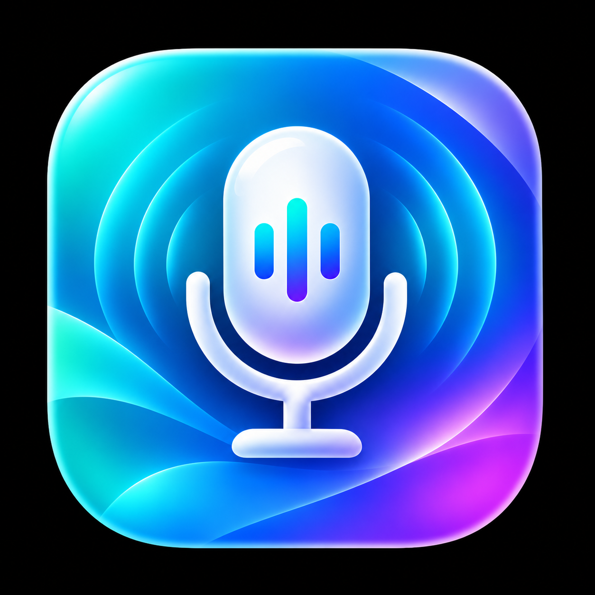
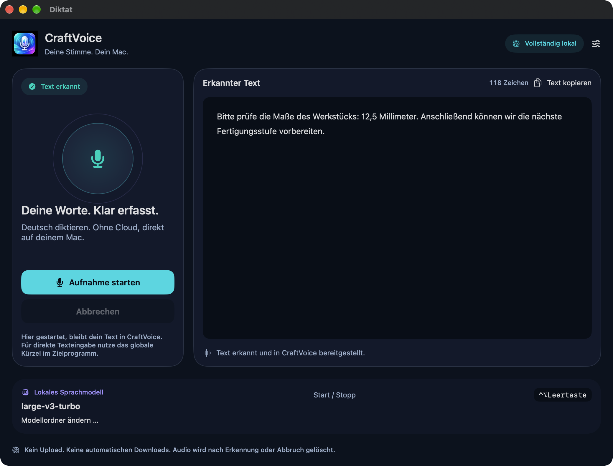
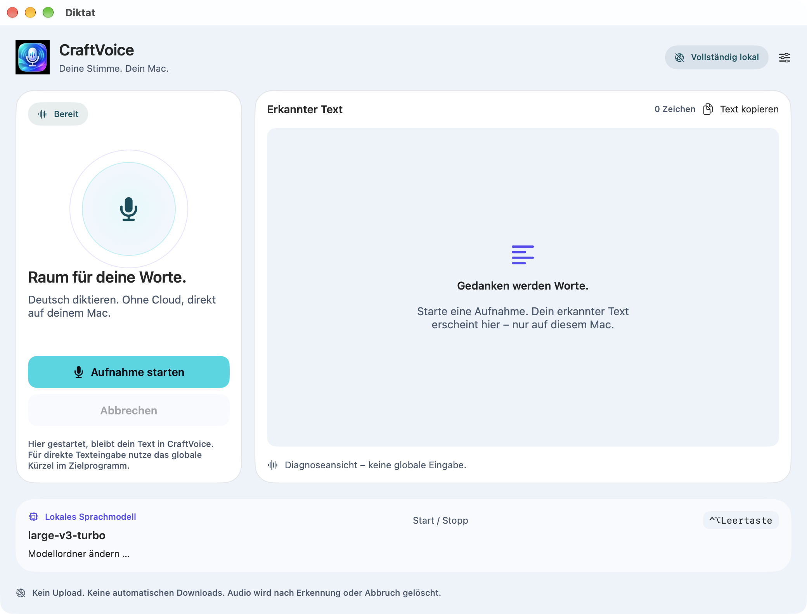
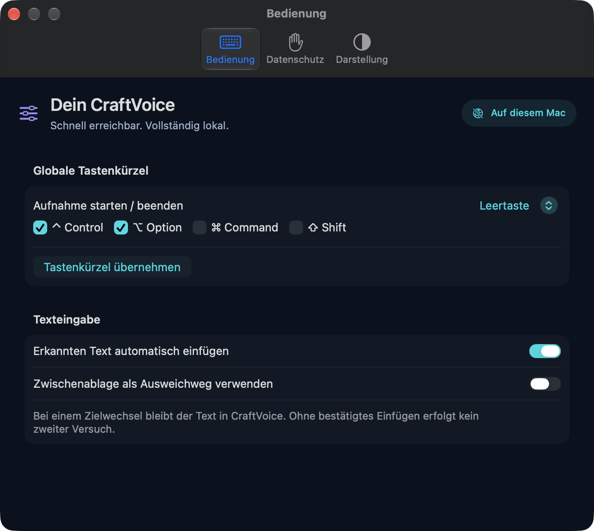

<p align="center">
  
</p>

# CraftVoice

**Deine Stimme. Dein Mac.**

CraftVoice ist eine native Diktierhilfe für deutsche Sprache auf dem Mac. Du sprichst, CraftVoice erkennt deinen Text lokal und fügt ihn auf Wunsch in das ursprüngliche Textfeld ein. Swift und SwiftUI bilden die Oberfläche; WhisperKit und Whisper large-v3-turbo übernehmen die Spracherkennung auf deinem Mac.

## Funktionen

- Deutsche Spracherkennung mit lokalem Sprachmodell, ohne Cloud-Transkription.
- Menüleisten-App mit globalem, anpassbarem Start-/Stopp-Kürzel.
- Diktatfenster mit lesbarem Transkript, Zeichenanzahl und manueller Kopieraktion.
- Automatische Texteingabe mit Prüfung des ursprünglichen Ziels; bei Unsicherheit bleibt das Ergebnis in CraftVoice.
- Klar unterscheidbare Zustände für Aufnahme, Erkennung, bereitgestellten Text und bestätigtes Einfügen.
- Premium-Oberfläche mit dunkler, heller und systemabhängiger Darstellung.
- Zwischenablage als ausdrücklich aktivierbarer Ausweichweg; standardmäßig ausgeschaltet.

## Voraussetzungen

- Mac mit Apple Silicon und macOS 26 oder neuer.
- Mikrofon und Mikrofonfreigabe für CraftVoice.
- Für automatische Eingabe in andere Apps die in CraftVoice angezeigten Bedienungshilfen-/Eingabeüberwachungsrechte, soweit vom gewählten Eingabeweg benötigt.
- Vollständiges lokales large-v3-turbo-Modell einschließlich Tokenizer: etwa 1,64 GB zusätzliche Dateien, zuzüglich Speicher für App und Laufzeit.
- Für Quellcode-Builds: Xcode Command Line Tools mit Swift 6.2 oder neuer sowie Python 3. Die bisherige Entwicklungsumgebung verwendete Swift 6.4.2; weitere Toolchains und Mac-Konfigurationen sind gesondert zu prüfen.

## Bedienung

1. CraftVoice über die Menüleiste öffnen und den lokalen Modellordner bereitstellen.
2. Im gewünschten Zielprogramm in ein unterstütztes Textfeld klicken.
3. **⌃⌥Leertaste** (Control + Option + Leertaste) drücken, sprechen und zum Beenden erneut drücken.
4. CraftVoice erkennt den Text und versucht bei aktivierter automatischer Eingabe, ihn einmalig in das erfasste Textfeld einzufügen.

Das Kürzel lässt sich unter **Einstellungen → Bedienung** ändern. Während der Modellvorbereitung bricht erneutes Drücken ab. Es gibt keine Push-to-Talk-Funktion. Eine Aufnahme über den Button im Diktatfenster stellt das Ergebnis in CraftVoice bereit; mit **Text kopieren** kannst du es selbst übernehmen. Ein Diktat ist auf 120 Sekunden begrenzt. Das Schließen des Fensters beendet die Menüleisten-App nicht.

## Lokale Sprachverarbeitung und Datenschutz

Die Erkennung verwendet lokale Modelldateien. Die App lädt keine Modelle automatisch nach und überträgt Aufnahmen nicht zur Cloud-Transkription. Für die einmalige Modellbereitstellung und das erstmalige Laden der Build-Abhängigkeiten ist Internetzugang erforderlich.

Aufnahmen werden vorübergehend lokal abgelegt und im regulären Abschluss- oder Abbruchpfad gelöscht. Das ist keine Garantie sicherer Datenvernichtung oder der Bereinigung nach einem Prozessabsturz. Erkannter Text bleibt im geöffneten Diktatfenster sichtbar. Die automatische Eingabe prüft dazu vorübergehend Ziel- und Feldinhalte. Zielprogramme verarbeiten eingefügten Text nach ihren eigenen Regeln, einschließlich einer eventuell dort verwendeten Cloud.

Die optionale Entwicklerdiagnose über `CRAFTVOICE_DIAGNOSTICS_DIR` kann Audio, Transkripte und Feldinhalte lokal speichern. Sie ist im normalen Betrieb ausgeschaltet und sollte für private Diktate nicht aktiviert werden. Diagnoseordner gehören niemals in öffentliche Fehlerberichte.

## Modellbereitstellung

Das Sprachmodell gehört weder zum Quellcode-Repository noch zum derzeitigen App-Bundle. CraftVoice verwendet die Core-ML-Variante `openai_whisper-large-v3-v20240930_turbo` von Argmax und die dazu festgelegten OpenAI-Tokenizerdateien.

Das vorhandene Bereitstellungswerkzeug wird bewusst separat ausgeführt:

```sh
python3 tools/provision-local-model.py
python3 tools/provision-local-model.py --verify-only
```

Der erste Befehl lädt die festgelegten offiziellen Dateien herunter. Der zweite prüft den lokalen Bestand ohne Download. Standardordner:

```text
~/Library/Application Support/CraftVoice/Models/large-v3-turbo
```

Alternativ lässt sich in CraftVoice ein vollständiger kompatibler Ordner auswählen. Dateigrößen und Hashes werden bei der Bereitstellung geprüft. Fehlende oder beschädigte Assets führen zu einem Fehler statt zu einem automatischen Download. Quellen, Revisionen und Lizenzpflichten stehen in [MODELL.md](docs/MODELL.md).

## Installation

### Fertige macOS-App

Es gibt derzeit keinen öffentlichen App-Download, keinen freigegebenen Installer und keinen GitHub Release. Für eine spätere App-Verteilung ist ein mit Developer ID signiertes und von Apple notarisiertes Apple-Silicon-Build vorgesehen.

### Aus dem Quellcode

Im Projektordner lässt sich der Code ohne App-Installation kompilieren:

```sh
./build.sh --compile-only
```

Beim ersten Build lädt SwiftPM die festgelegten Abhängigkeiten. `./build.sh --compile-only` erzeugt nur das Programm. `./build.sh` erstellt zusätzlich ein lokal ad-hoc-signiertes App-Bundle im lokalen macOS-Temporärverzeichnis unter `CraftVoiceDeveloper/<Projektkennung>/bundles/build-*/CraftVoice.app`, ohne persönliches Zertifikat und ohne Installation. Die Ad-hoc-Signatur ist für lokale Entwicklung bestimmt; sie ersetzt keine Developer-ID-Signierung oder Apple-Notarisierung. Details und Grenzen: [Entwickler-Build](docs/ENTWICKLER-BUILD.md).

## Bekannte Einschränkungen

- Aktuell deutsche Transkription; keine Übersetzung, Cloud-Verarbeitung oder nachgelagerte Grammatik-KI.
- Apple Silicon ist Zielplattform; Intel-Macs sind nicht als unterstützt freigegeben.
- Erkennungsfehler und erfundene Wörter sind möglich. Prüfe wichtige Texte selbst.
- Nicht jedes Textfeld unterstützt sichere automatische Eingabe. Geschützte Felder, Fokuswechsel oder veränderter Inhalt können sie verhindern.
- Nach möglicherweise erfolgter Eingabe gibt es keinen automatischen zweiten Versuch. „Nicht bestätigt“ ist keine Einfügebestätigung.
- Das Modell benötigt zusätzlichen Speicher; die erste Vorbereitung kann dauern. Der aktuelle Standard verwendet CPU/GPU.
- Das Diktatfenster benötigt ausreichend Bildschirmplatz (Mindestformat 900 × 760 pt).
- Die öffentliche Distribution und die vollständige Prüfung auf weiteren Macs stehen noch aus.

## Screenshots

Echte Fensteraufnahmen des Premium-Designs aus der vorhandenen visuellen Abnahme. Die Ansichten verwenden synthetische Diagnosezustände und einen neutralen Beispieltext; sie zeigen keine privaten Diktate und sind kein neuer Sprach- oder Eingabetest.



<details>
<summary>Heller Modus und Bedienung</summary>





</details>

## Entwicklung

Der Code ist in App, Core, Speech und Integration getrennt. Prüfprogramme und Tests liegen separat. Siehe [ARCHITEKTUR.md](docs/ARCHITEKTUR.md), [CONTRIBUTING.md](CONTRIBUTING.md) und [Drittanbieterhinweise](THIRD_PARTY_NOTICES.md).

## Lizenz

Für den eigenen CraftVoice-Quellcode gilt die im Repository enthaltene [MIT-Lizenz](LICENSE). Der [Lizenzumfang](LICENSE-SCOPE.md) grenzt Drittanbieter und Bildmaterial ab. Drittanbieterbestandteile behalten ihre jeweiligen Lizenzbedingungen. Das Originalicon wurde mit ChatGPTs Bildgenerierung speziell für CraftVoice erstellt und als offizielles App-Icon ausgewählt. Icon und Screenshots sind von der Code-MIT-Lizenz ausgenommen. Herkunft und Nutzungsbedingungen stehen in der [Rechteprüfung](docs/RECHTE.md).

## Danksagungen

Danke an **Dave Ebbelaar** und [BAMA – Build Any Mac App](https://github.com/daveebbelaar/bama). Die BAMA-Skills wurden als Entwicklungswerkzeug für Planung, Gestaltung, SwiftUI-Umsetzung, Prüfung und Veröffentlichungsplanung verwendet. BAMA ist keine Laufzeitabhängigkeit von CraftVoice. Übernommene Vorlagenbestandteile werden zusätzlich mit dem [BAMA-MIT-Lizenztext](Resources/ThirdParty/BAMA-LICENSE.txt) gewürdigt.

Danke an [Argmax / WhisperKit](https://github.com/argmaxinc/WhisperKit) für die lokale Spracherkennungsintegration, an [OpenAI / Whisper](https://github.com/openai/whisper) für das Sprachmodell und an die Mitwirkenden der verwendeten Open-Source-Komponenten.
